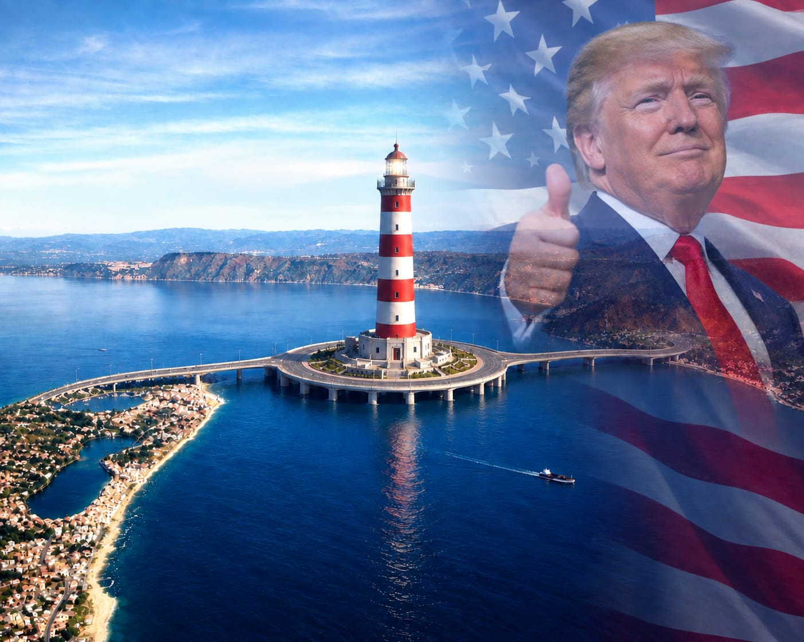

**The Canapas**

## Italy

# Strait of Messina Bridge Moves Forward with New Roundabout Plan

*A new project for the Strait of Messina has been approved: a roundabout will be built. Donald Trump approved.*

Di **Andrea Savarino** · 24 settembre 2026

*Rappresentazione del progetto: la rotonda con il faro al centro dello Stretto.*

The Strait of Messina Bridge project moves forward with a new roundabout plan, marking another step toward the development of the long-awaited connection between Sicily and mainland Italy. The first time, Matteo Salvini tried to build a bridge to connect Sicily to Calabria. Now a new project to build a roundabout over the strait has been chosen instead of the first idea. This new decision has been discussed all over the world.

The big roundabout, with a radius of 500 meters, will be built in the perfect center of the strait. The bridge will have 6 lanes in total, will be 60 meters wide and 3.6 kilometers long. There will be 14 meters between the outgoing and return lanes.

## Dati principali

- Raggio della rotonda: **500 m**
- Corsie: **6** · Larghezza: **60 m** · Lunghezza: **3,6 km**
- Distanza tra corsie di andata e ritorno: **14 m**
- Altezza del faro: **98 m** · Diametro della luce: **6 m**
- Addetti al monitoraggio delle navi: **20**, 24 ore su 24
- Posti di lavoro stimati: circa **150.000**
- Tempi: **6-7 anni** secondo Salvini, **13 anni** secondo gli esperti (ritardi esclusi)

## The lighthouse

Over the center of the roundabout will be built the biggest lighthouse of the Mediterranean Sea: a huge building 98 meters high. The lighthouse will be useful for the ports of Messina and Reggio Calabria. It will have 20 people monitoring the movement of the ships in the bay at every hour of the day. The light on top of the structure will be 6 meters in diameter.

## A railway under the sea

Under it, a railway will be built under the sea; the idea comes from the English Channel between the United Kingdom and France. The railway will allow people who don't have a car to go over (or in this case under) the strait without waiting hours for a ferry.

## Jobs and timing

Analytics says that this project will give work to approximately 150,000 people, more than any other project in the history of Italy. Matteo Salvini talked about 6 or 7 years of construction, but experts say it is impossible to do it in such a short time. They talked about 5 more years of non-stop building, for a total of 13, excluding delays or sudden incidents.

## Why a circular design?

But someone might ask: why this change? The experts answered that the choice of a circular design was not accidental. Studies have shown that in an area like the Strait of Messina, where the ocean floor has complex geological characteristics, strong currents, seismic activity and significant wind exposure, a circular structure could theoretically distribute forces more evenly than a conventional linear bridge.

Another advantage of the circular configuration is that the structure could be divided into several interconnected sections; this would help to distribute the weight and stress across multiple support points rather than relying on one linear support.

## Materials

High-strength steel would be used for the main circular deck, keeping the structure relatively lightweight, which is important in a location exposed to wind and seismic forces. Reinforced concrete would be used for the main foundations and anchoring systems, providing the necessary strength and rigidity to transfer loads safely.

## Donald Trump's statements

> “I looked at it, and I said, 'Matteo, this is big.' Many people said you couldn't put a roundabout in the sea. They said, 'Sir, the water is too deep, the waves are too high.' I said, wrong!”

---

© 2026 The Canapas
